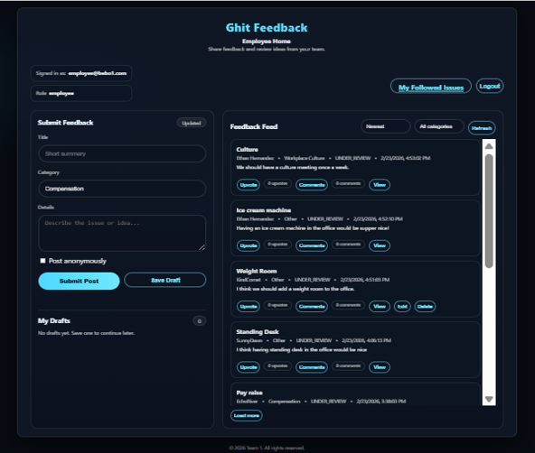
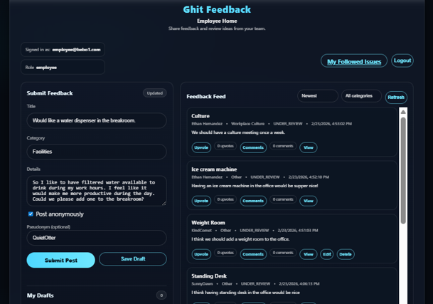
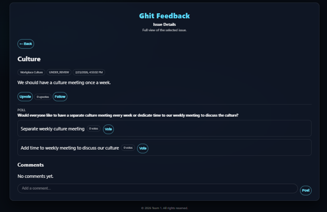
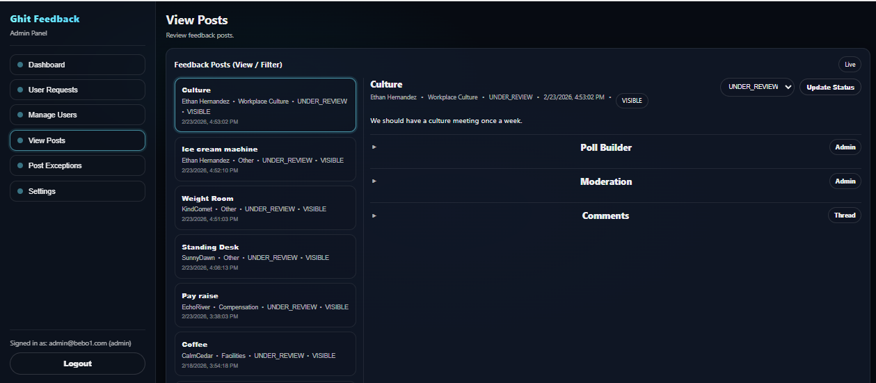
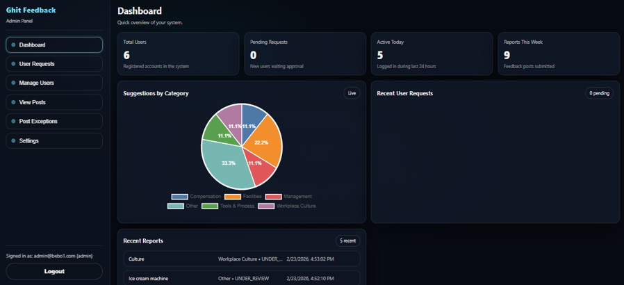
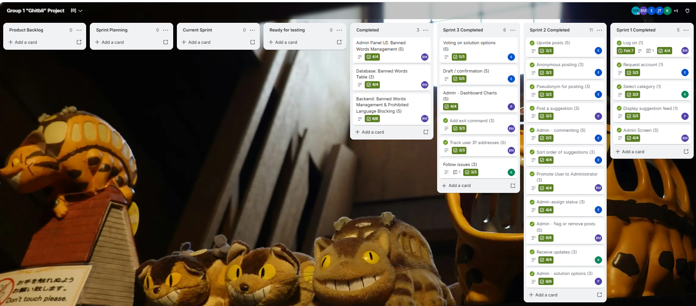

# Ghit Feedback — Product Owner Case Study (CIS 440 Capstone)

**Role:** Product Owner  
**Methodology:** Agile / Scrum (Trello)  
**Team:** 6-person cross-functional team (1 Product Owner, 1 Scrum Master, 4 Developers)  

---

## 1. Project Overview
**Ghit Feedback** is an internal, social-media-style employee feedback web platform designed to replace tedious traditional workplace surveys. As Product Owner, I defined the product vision, researched workplace pain points, authored and prioritized 15+ user stories (69 total story points), and guided sprint deliverables across role-based Employee and Administrator interfaces.

*(Note: Application source code was built by the team's four developers and is hosted in a private team repository. This repository documents my Product Owner artifacts, requirements analysis, UI walkthrough, and Agile sprint execution.)*

---

## 2. Problem Space & Pain Points Addressed
Through stakeholder and user analysis, I identified five core barriers preventing honest workplace feedback:
* **Survey Fatigue:** Employees find traditional surveys tedious and time-consuming.
* **Lack of Trust:** Employees doubt surveys lead to meaningful action because progress is invisible.
* **Fear of Retaliation:** Employees hesitate to share honest feedback under their real names.
* **Unactionable Anonymity:** Unstructured anonymous comments lack context and prevent follow-up.
* **Prioritization Blind Spots:** Leadership struggles to identify which issues matter most to the broader team.

---

## 3. Core Product Features & UI Walkthrough

### Employee Suggestion Feed & Draft Management
Employees view all submitted workplace ideas in a centralized feed, filter by category, sort by recency or upvotes, and save unfinished feedback as drafts before publishing.

### Pseudonym-Based Anonymous Posting
To encourage honest feedback without sacrificing accountability, employees can toggle anonymity on any post and receive a randomized alias (e.g., *QuietOtter*), enabling safe honesty while allowing managers to follow a user's thread.

### Issue Following & Management Solution Polling
Employees can follow specific issues for status updates and vote directly on management-proposed solution polls so leadership prioritizes widely supported initiatives.

### Administrator Moderation & Status Workflows
Administrators review incoming feedback posts, update issue statuses (`Under Review`, `In Progress`, `Completed`), build custom solution polls, and moderate threads to maintain a constructive environment.

### Admin Dashboard Charts & Engagement Analytics
To give leadership immediate visibility into workplace trends, the Admin Dashboard tracks live system KPIs—including **Total Users**, **Pending Requests**, **Active Today**, and **Reports This Week**—alongside a visual **Suggestions by Category** breakdown chart (*Compensation, Facilities, Management, Tools & Process, Workplace Culture, and Other*).

---

## 4. Agile Execution & Backlog Highlights
* **Backlog Prioritization:** Decomposed user pain points into 15+ user stories sized from 1-point quick wins to 5-point epics.
* **Sprint Velocity & Delivery:** Managed backlog refinement and acceptance criteria across multi-week sprints, tracking 69 story points to completion via Trello and burndown charts.
* **Cross-Functional Alignment:** Facilitated story estimation discussions and resolved duplicate feature implementations during sprint retrospectives to keep engineering effort focused.

